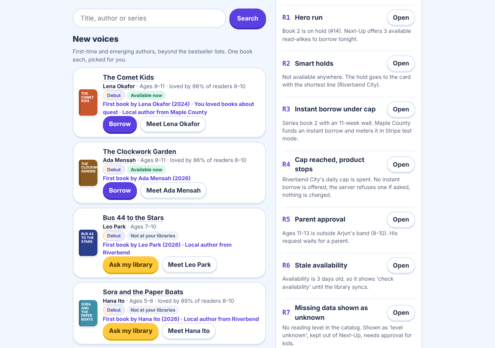
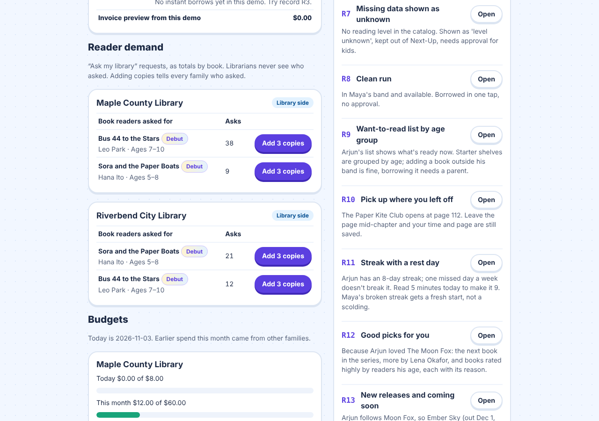
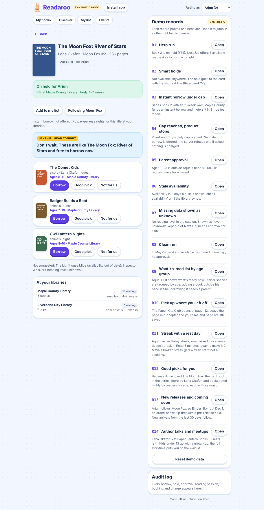
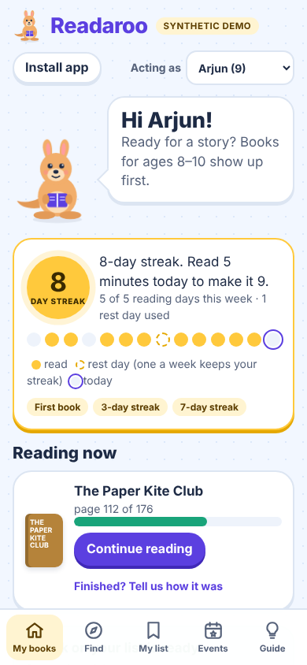
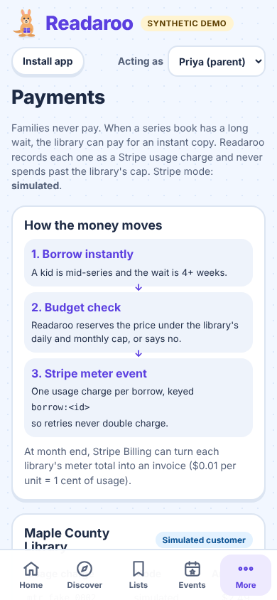
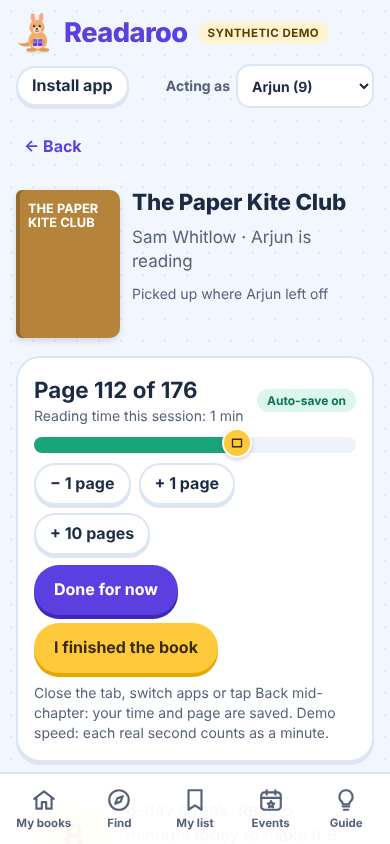
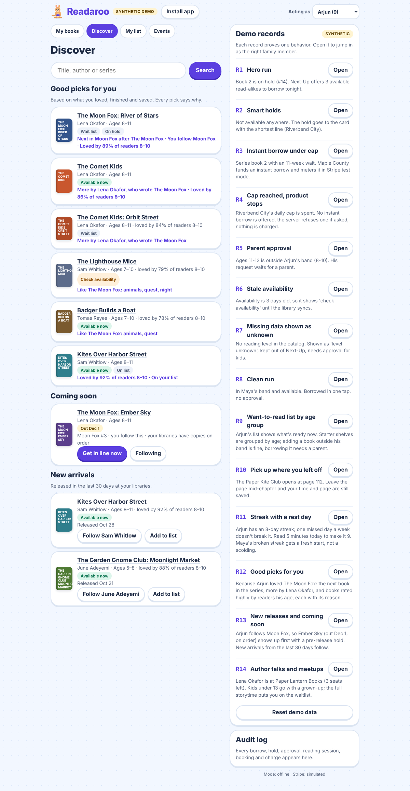
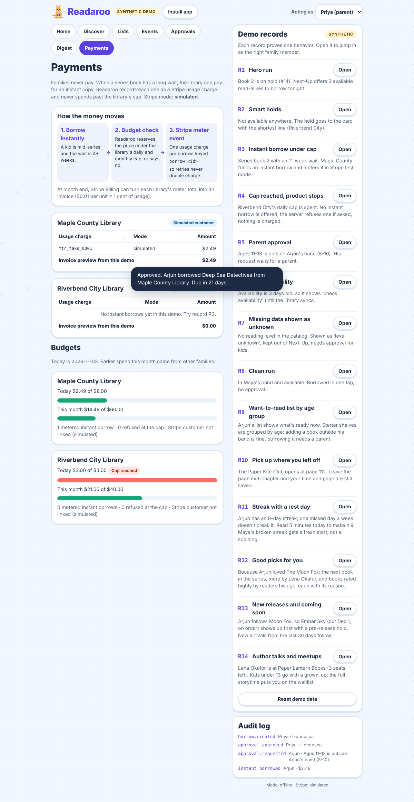
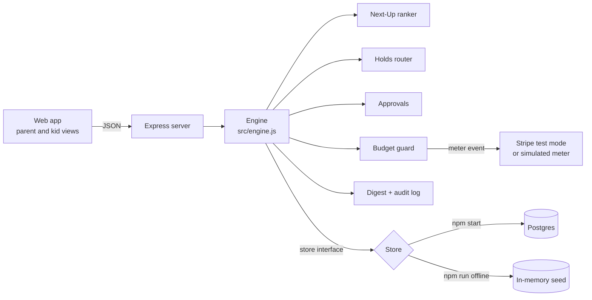

# Readaroo

**Never wait for the next book, and never read alone.**

Readaroo is a family library app prototype. When a book your kid wants is on hold, it finds similar books you can borrow from your libraries tonight. It keeps one holds list across every library card in the family, lets parents set age bands and approve exceptions, and sends a weekly family reading digest. Libraries can fund instant borrows for series continuations, metered through Stripe in test mode, with a hard daily and monthly cap that is never exceeded.

Version 0.2 adds the everyday reading life around the library:

- **Want-to-read lists by age group:** a list per person, plus librarian starter shelves grouped by age (kids also see the next level up, to borrow with a grown-up's OK).
- **A reading tracker that saves your place:** open a book, read, close the tab mid-chapter. Your page and minutes are saved anyway.
- **Good picks:** recommendations from what each reader loved, finished, saved and follows, each with a reason.
- **Streaks with a rest day:** five minutes a day counts, and one missed day a week doesn't break it.
- **New releases:** follow a series or author; sequels show up first, and you can get in line before release day.
- **Author talks and meetups:** readings, signings, storytimes and book clubs at libraries and bookstores, matched to what your family reads. Kids ask; a grown-up books.

Version 0.4 helps new authors find readers, and helps libraries see what their community wants:

- **Author discovery:** a **New voices** shelf in Discover with one book each from first-time and emerging authors, beyond the bestseller lists, and an author page with a bio, books, events and a follow button.
- **Author engagement:** online and in-person author events. Families send questions ahead of time; a kid's question waits for a parent before it goes to the author.
- **Reader interest signals:** **Ask my library** on books your libraries don't own yet. Librarians see the totals by book (never names), add copies, and every family who asked is told.
- **Community-driven discovery:** **Loved by families near you** (totals only), and recommend a book you read to someone in your family with a short note, or copy a share line for a friend.

<p>
  
  
</p>



> **All data is fictional.** Every family member, library, book and author is synthetic. Stripe runs in test mode only, and the app refuses to start with a live key.

## Contents

- [Why this exists](#why-this-exists)
- [Where Stripe fits](#where-stripe-fits)
- [Get it on your phone](#get-it-on-your-phone)
- [Try it in 2 minutes with no accounts](#try-it-in-2-minutes-with-no-accounts)
- [Ways to run it](#ways-to-run-it)
- [Using the app](#using-the-app)
- [The demo records](#the-demo-records)
- [How it works](#how-it-works)
- [Beyond the prototype](#beyond-the-prototype)
- [Full setup](#full-setup)
- [Configuration reference](#configuration-reference)
- [HTTP API](#http-api)
- [Testing](#testing)
- [Project layout](#project-layout)
- [Security and data handling](#security-and-data-handling)
- [Troubleshooting](#troubleshooting)
- [FAQ and known limitations](#faq-and-known-limitations)
- [License](#license)

## Why this exists

Kids are reading for fun less, and the free library apps families rely on either make them wait or ration instant access.

| Signal | Number | Source |
| --- | --- | --- |
| 9-year-olds who read for fun almost every day | 53% in 2012, 39% in 2022 | [NEA, citing NAEP](https://www.arts.gov/stories/blog/2024/federal-data-reading-pleasure-all-signs-show-slump) |
| 13-year-olds who read for fun almost every day | 27% in 2012, 14% in 2023 | [NEA, citing NAEP](https://www.arts.gov/stories/blog/2024/federal-data-reading-pleasure-all-signs-show-slump) |
| Digital library checkouts via Libby and Sora | 820.5 million in 2025, up 10% | [OverDrive](https://company.overdrive.com/?p=69755) |
| Cost per checkout at one library | $2.04 pay-per-use vs $0.92 licensed copies | [GADML](https://www.gadml.org/about-4) |
| Pay-per-use rationing | One library cut monthly borrows from 5 to 3 in 2025 | [Halifax Public Libraries](https://www.halifaxpubliclibraries.ca/news/change-to-hoopla-borrowing-limit/) |

**The insight:** library apps lend to one reader and make them wait. Readaroo lends to the family and turns the wait into a read.

| Principle | What it means in the product |
| --- | --- |
| Read tonight | A hold always comes with books you can borrow now |
| The family is the user | One account, kid profiles, one holds list across cards |
| A window, not a wall | Kids ask; parents approve exceptions; in-band books just work |
| Never overspend | Instant borrows are capped inside a database transaction |
| Say what you don't know | Old availability says "check availability"; unknown reading levels say "level unknown" |

## Where Stripe fits

Families never pay. When a kid is mid-series and the wait is four weeks or more, the library can pay for an instant copy:

1. **Borrow instantly** on the book page (demo record **R3**).
2. Readaroo reserves the price under the library's daily and monthly cap, inside one database transaction, or refuses (record **R4**).
3. It records a **Stripe Billing meter event** for the library's Stripe customer, keyed `borrow:<id>` so a retry never double charges. If Stripe fails, the borrow is cancelled and the budget released.
4. At month end, Stripe Billing can invoice each library for its meter total.

See it on the **Payments** screen. The code is in `src/stripeMeter.js` and `scripts/stripe-setup.js`; setup is in [docs/SETUP_STRIPE.md](docs/SETUP_STRIPE.md). The demo simulates Stripe; with your own `sk_test_` key the charges reach your Stripe test account.

## Try it in 2 minutes with no accounts

You need [Node.js 18 or newer](https://nodejs.org) (`node -v` to check). No database, no Stripe account.

```bash
git clone https://github.com/<your-username>/readaroo.git
cd readaroo
npm ci
npm run offline
```

Open http://127.0.0.1:3000. Press `Ctrl+C` to stop.

**No Git?** On the GitHub page click **Code → Download ZIP**, unzip it, open a terminal in the folder and run `npm ci` then `npm run offline`.

**No Node either?** Open `demo/readaroo-demo.html` in any browser. It is the same app and engine in one offline file.

## Get it on your phone

Readaroo installs like an app: a home-screen icon, full screen, and it opens offline.

- **Quickest:** run `READAROO_HOST=0.0.0.0 npm run offline`, open `http://<your computer's IP>:3000` on your phone (same Wi-Fi), then **Share → Add to Home Screen** (iPhone) or **Install app** (Android).
- **Native app:** `npm run mobile:android` or `npm run mobile:ios` builds a real app with Capacitor. The engine and demo data run on the phone, no server needed.
- **App Store and Google Play:** Apple's developer program is 99 USD a year; Google Play is a 25 USD one-time fee. Kids' apps have extra rules.

Step by step: [docs/MOBILE.md](docs/MOBILE.md).

<p>
  
  
</p>

## Ways to run it

| Mode | Command | Database | Stripe | Use it for |
| --- | --- | --- | --- | --- |
| Single-file demo | open `demo/readaroo-demo.html` | in the page | simulated | Sharing with anyone |
| Offline | `npm run offline` | in memory, reset on restart | simulated | Local demos, development |
| Live | `npm start` | Postgres | simulated, or test mode with a key | The real build |
| Phone app | `npm run mobile:android` / `mobile:ios` | on the phone | simulated | Showing it on a real phone |

## Using the app

Pick who you are with **Acting as** in the top right. Parents see Home, Discover, Lists, Events, Approvals, Digest and Payments. Kids get a bigger, sunnier view: My books, Find, My list and Events, with Roo the kangaroo cheering them on. On a phone the main sections sit in a bottom tab bar; parents find Approvals, Payments, Digest and the Demo guide under **More**.

| Screen | What you can do |
| --- | --- |
| Home (parent) | Everyone's streak, reading progress, holds, list books ready to borrow, the next event for your family, requests to review |
| My books (kid) | Streak card with the last 14 days, Continue reading, react to a finished book (Loved it / It was OK / Not for me) |
| Reader | Page and time tracking: + 1 page, + 10 pages, Done for now, I finished the book. Leaving mid-chapter still saves |
| Discover | Search, New voices (debut and emerging authors, Ask my library for books not owned yet), From your family, Good picks with reasons, Loved by families near you, Coming soon and New arrivals |
| Lists | Each person's want-to-read list (ready books first) and librarian shelves by age group |
| Events | Author talks (online and in person), signings, storytimes and book clubs. Parents tick who's going and Book free seats or Join the waitlist; kids tap Ask to go. Ask the author a question ahead of time |
| Author page | Bio, first-book year, hometown, every book with its status, upcoming online and in-person events, Follow |
| Book page | Borrow now, Place hold (shortest line), Borrow instantly, Refresh availability, Next-Up suggestions with Borrow / Good pick / Not for us, Ask my library, Recommend or share |
| Approvals | Approve this book, Approve the series, or Not now; event requests: Book it or Not this time; kids' questions for authors: Send it or Don't send |
| Digest | Books finished, reading time, days read, streaks, kid reactions and a conversation starter per book |
| Payments and reader demand | How the money moves, every Stripe usage charge with an invoice preview per library, what readers asked each library for (Add 3 copies), and each library's daily and monthly budget |
| Demo guide | Open any demo record, see the audit log, or Reset demo data (offline only) |

<p>
  
  
</p>



**The owner rule:** only a parent can approve or decline requests. A parent borrowing for their own kid is the approver, so no request is created.

## The demo records

Each record proves one behavior. In the app, open them from the **Demo guide**.

| # | Record | What it proves |
| --- | --- | --- |
| R1 | *The Moon Fox: River of Stars* on hold for Arjun (#14) | **Hero run.** Next-Up offers three available read-alikes: same author, shared themes, in his age band |
| R2 | *Starlight Express Club* | **Smart holds.** The hold goes to Riverbend City (2–3 weeks), not Maple County (8–13 weeks) |
| R3 | *The Comet Kids: Orbit Street* | **Instant borrow under cap.** Series book 2, long wait, Maple County pays $2.49, metered once |
| R4 | *Tidecallers: The Salt Gate* | **The product stops.** Riverbend City's daily cap is spent. No instant borrow is offered, the API refuses one, nothing is charged |
| R5 | *Deep Sea Detectives* (ages 11–13) | **Caught exception.** Outside Arjun's band (8–10), so his request waits for a parent |
| R6 | *The Lighthouse Mice* | **Stale data.** Availability is 3 days old: "check availability" until refreshed, and borrowing is blocked |
| R7 | *Inspector Whiskers* | **Missing data shown as unknown.** No reading level: "Level unknown", left out of Next-Up, kids need approval |
| R8 | *Puddle Jumpers* for Maya | **Clean run.** In band and available: borrowed in one tap |
| R9 | Arjun's list | **Lists by age group.** Ready books first; the 8–10 shelf, plus the 11–13 shelf marked "Next level up". Grown-up books can't be added by kids |
| R10 | *The Paper Kite Club* | **Pick up where you left off.** Opens at page 112. Close the tab mid-chapter and the time and page are saved; a repeat save never double counts |
| R11 | Arjun's streak | **Streak with a rest day.** 8 days with Oct 28 as the week's rest day. Read 5 minutes today to make it 9. Maya gets "Fresh start", not a scolding |
| R12 | Arjun's picks | **Good picks.** The next Moon Fox book first ("Next in Moon Fox after The Moon Fox"), then more by Lena Okafor and highly rated books for ages 8–10 |
| R13 | *The Moon Fox: Ember Sky* | **New releases.** Arjun follows Moon Fox, so the Dec 1 sequel is first in Coming soon, with a hold counted from release day |
| R14 | *Lena Okafor: drawing the Moon Fox* | **Author talks and meetups.** Matched because Arjun loved the book. Booking Arjun adds Priya (under-13s go with a grown-up). The full storytime puts you on the waitlist |
| R15 | Lena Okafor's author page | **A new voice.** Her first book, *The Comet Kids* (2024), comes first; an online talk and a bookstore talk; Follow adds her to Discover |
| R16 | *Bus 44 to the Stars* by Leo Park | **Ask my library.** A debut no family library owns. 49 families already asked; Arjun's ask makes 50. A second ask is refused politely; owned books can't be requested |
| R17 | *Live from the launchpad* (online) | **Questions for authors.** Arjun's question waits in Approvals; Priya sends it and the count goes up. Three questions per person per event |
| R18 | Arjun's Discover | **New voices and community picks.** One book per new author with reasons ("First book by Leo Park (2026)", "Local author from Maple County"), and books loved by families at your libraries |
| R19 | Payments and reader demand | **The library side.** Requests as totals by book, no names. Add 3 copies of *Bus 44*: it's borrowable at once and every family who asked sees "Your request worked" |



## How it works



One engine holds every rule. The server, the tests and the single-file demo all run it, so they can't drift apart.

| Step | Reads | Produces | Guardrail |
| --- | --- | --- | --- |
| Availability | copies per library, `as_of` | available, wait list, or "check availability" | Older than 24 hours is never shown as available |
| Next-Up | held title, member's band and history, fresh copies | up to 3 ranked read-alikes with reasons | Unknown levels and stale copies are excluded and listed |
| Holds router | queue and copies at each family library | a hold at the shortest line | One hold per member per title |
| Approvals | member band, title level | a pending request, or nothing | Only parents decide; unknown level counts as outside the band |
| Budget guard | library caps and spend | a reservation, or a refusal | Row lock in Postgres; refuse before metering |
| Metering | reservation | a Stripe meter event | Idempotency key `borrow:<id>`; budget released if Stripe fails |
| Audit | every action | an `events` row | The app's database role cannot update or delete events |

More detail: [docs/ARCHITECTURE.md](docs/ARCHITECTURE.md).

## Beyond the prototype

- **Real library catalogs:** swap the synthetic catalog for a library's availability feed behind the same store interface.
- **Readaroo Plus:** an optional family subscription through Stripe Checkout (test mode).
- **Ticketed author events:** bookstores sell tickets through Readaroo with Stripe Connect, paying the store directly.
- **Real event feeds:** pull library event calendars and bookstore listings instead of synthetic meetups.
- **Native apps:** the API is ready for an iOS or Android client.
- **Claude through MCP:** expose `/api/titles` and Next-Up as tools so a parent can ask "what can Arjun read tonight?"
- **Librarian console:** set caps, curate read-alike lists, and see holds deflected by Next-Up.
- **A live model for reasons:** generate warmer Next-Up explanations, keeping the scored reasons as the source of truth.

## Full setup

1. **Postgres:** [docs/SETUP_POSTGRES.md](docs/SETUP_POSTGRES.md) creates the database, tables, the least-privilege `readaroo_app` role and the demo data.
2. **Stripe (optional):** [docs/SETUP_STRIPE.md](docs/SETUP_STRIPE.md) creates a test-mode meter and one test customer per library.
3. Run `npm start` and open http://127.0.0.1:3000. The footer in the Demo guide shows `Mode: live` and the Stripe mode.

## Configuration reference

Set these in `.env` (copy `.env.example`). Offline mode needs none.

| Variable | Required | Meaning |
| --- | --- | --- |
| `DATABASE_URL` | Live mode | Connection string the app uses (the `readaroo_app` role) |
| `DATABASE_ADMIN_URL` | Setup scripts | Owner connection for `npm run db:setup`, `db:seed`, `stripe:setup` |
| `READAROO_APP_PASSWORD` | Optional | Password set on `readaroo_app` during `db:setup` |
| `STRIPE_SECRET_KEY` | Optional | Stripe test key (`sk_test_…` or `rk_test_…`). Empty = simulated. Live keys are refused |
| `STRIPE_METER_EVENT_NAME` | Optional | Defaults to `readaroo_instant_borrow` |
| `PORT` | Optional | Defaults to 3000 |
| `READAROO_HOST` | Optional | Defaults to `127.0.0.1` (only your computer). `0.0.0.0` opens it to your network |
| `READAROO_OFFLINE` | Optional | `1` forces offline mode |

Settings stored in the database (`app_config` table, generated from `data/generate_data.py`):

| Key | Default | Meaning |
| --- | --- | --- |
| `now` | `2026-11-03T19:00:00Z` | The demo's pinned "today" |
| `instantWaitThresholdDays` | 28 | Instant borrow only when the shortest wait is at least this long |
| `staleHours` | 24 | Availability older than this shows "check availability" |
| `daysPerQueueTurn` | 10 | Rough days per turn in a hold line, for wait estimates |
| `streakMinMinutes` | 5 | Minutes in a day that count toward a streak |
| `weeklyGoalDays` | 5 | Reading days per week shown as the goal |
| `readingSecondsPerMinute` | 1 | Demo speed for the reader: 1 real second counts as a minute. Set 60 for real use |
| `newArrivalDays` | 30 | How recent a release must be to show under New arrivals |

## HTTP API

Every request names the acting family member as `actor` (query string for GET, JSON body for POST). Errors return JSON `{ "error": "...", "code": "..." }` with a 4xx status.

| Method | Path | Body or query | Returns |
| --- | --- | --- | --- |
| GET | `/api/health` | | `{ ok, mode, stripe }` |
| GET | `/api/home` | `actor` | Family, members, cards, holds, reading now, pending approvals |
| GET | `/api/titles` | `actor`, `member`, `q` | Search results with status and band |
| GET | `/api/titles/:id` | `actor`, `member` | Availability, hold, instant eligibility, Next-Up |
| POST | `/api/borrow` | `actor`, `member`, `titleId` | `borrowed`, `approval_required` or 409 |
| POST | `/api/holds` | `actor`, `member`, `titleId` | `hold_placed` at the shortest line |
| POST | `/api/instant` | `actor`, `member`, `titleId` | `instant_borrowed` or `instant_refused` (with hold and Next-Up) |
| POST | `/api/approvals/:id` | `actor`, `decision` (`approve`, `approve_series`, `decline`) | Outcome and fulfilment |
| POST | `/api/reactions` | `actor`, `borrowId`, `reaction` (`loved`, `ok`, `not_for_me`) | `reacted` |
| POST | `/api/feedback` | `actor`, `heldTitleId`, `suggestedTitleId`, `vote` (`up`, `down`) | `recorded` |
| POST | `/api/refresh` | `actor`, `titleId` | Simulated library sync of availability |
| GET | `/api/reading/:borrowId` | `actor` | Page, progress and streak for the reader |
| POST | `/api/sessions` | `actor`, `borrowId`, `clientId`, `minutes` (1–600), `toPage` | Saves a reading session; the same `clientId` updates instead of adding |
| GET | `/api/streaks` | `actor` | Current and longest streak, rest days, last 14 days, badges |
| GET | `/api/lists` | `actor`, `member` | Want-to-read list and shelves by age group |
| POST | `/api/tbr` | `actor`, `member`, `titleId` | Adds to a list |
| POST | `/api/tbr/remove` | `actor`, `member`, `titleId` | Removes from a list |
| GET | `/api/discover` | `actor`, `member` | New voices, from your family, good picks with reasons, community picks, new arrivals, coming soon, follows |
| POST | `/api/follow` | `actor`, `member`, `kind` (`author`, `series`), `value`, `on` | Follow or unfollow |
| GET | `/api/meetups` | `actor` | Upcoming events, matched to the family |
| POST | `/api/meetups/:id/rsvp` | `actor`, `attendees` (member ids) | Parent: `going` or `waitlist`. Kid: `requested` |
| POST | `/api/meetups/:id/cancel` | `actor` (parent) | Cancels and frees the seats |
| POST | `/api/rsvps/:id` | `actor` (parent), `decision` (`approve`, `decline`) | Answers a kid's event request |
| GET | `/api/meetups/:id/ics` | | Calendar invite (`text/calendar`) |
| GET | `/api/authors/:name` | `actor`, `member` | Author profile, books, upcoming events, follow state |
| POST | `/api/library-requests` | `actor`, `member`, `titleId` | Ask my library: `asked` or `already_asked`; 409 `owned` if a family library has it |
| POST | `/api/library/order` | `libraryId`, `titleId`, `copies` (1–20) | Library side: adds digital copies and marks every request for it fulfilled |
| POST | `/api/meetups/:id/questions` | `actor`, `text` (3–200) | Parent: `sent`. Kid: `waiting_parent`. Max 3 per person per event |
| POST | `/api/questions/:id` | `actor` (parent), `decision` (`approve`, `decline`) | Sends or drops a kid's question |
| POST | `/api/recommendations` | `actor`, `titleId`, `to`, `note` (≤140) | Recommend a book you've read to someone in your family |
| GET | `/api/digest` | `actor` (parent) | Weekly totals, streaks and per-member books |
| GET | `/api/library` | | Budgets, spend, metered charges, refusals, reader demand per library (totals only) |
| GET | `/api/events` | `actor` | Latest 50 audit events |
| GET | `/api/demo-records` | | The 19 demo records |
| POST | `/api/reset` | | Restores demo data (offline only; 403 in live mode) |

## Testing

```bash
npm test
```

This starts the real server offline on a free port and walks every demo record (R1–R19) through the API, including failure paths: bad input, a kid trying to approve, stale data, the spend cap, a failed Stripe call, live-key refusal, repeated reading saves, the streak's rest day, age checks on events, a full room, duplicate library requests, a kid approving their own question, and recommending a book you haven't read.

To also test live mode against a throwaway Postgres (it reloads the demo data):

```bash
TEST_DATABASE_URL=postgres://readaroo_app:pw@localhost:5432/readaroo \
TEST_DATABASE_ADMIN_URL=postgres://postgres@localhost:5432/readaroo npm test
```

The live test also fires 10 parallel charges at one library and 10 parallel bookings at one event, and checks that neither the cap nor the room overflows. GitHub Actions runs both on every push (`.github/workflows/ci.yml`).

## Project layout

```
readaroo/
├── server.js               Express server, offline/live wiring, config checks
├── src/
│   ├── engine.js           Every product rule (runs in Node and the browser)
│   ├── memoryStore.js      Offline store + simulated Stripe meter
│   ├── postgresStore.js    Live store
│   └── stripeMeter.js      Stripe test-mode meter events, live-key guard
├── public/                 Web app (index.html, app.js, styles.css, api-http.js),
│                           installable-app files (manifest.webmanifest, sw.js, icons/)
├── data/
│   ├── generate_data.py    Builds every seed file
│   └── seed.json           Generated synthetic data
├── db/
│   ├── 001_schema.sql      Tables + least-privilege role
│   └── 002_seed.sql        Generated demo data
├── scripts/                db.js, stripe-setup.js, build-demo.js
├── demo/readaroo-demo.html Single-file offline demo
├── capacitor.config.json   Native iOS/Android app setup (builds into mobile/www)
├── resources/              App icon and splash screen for the native apps
├── test/                   smoke.test.js, features.test.js, live.test.js
└── docs/                   Setup guides, architecture, troubleshooting, screenshots
```

## Security and data handling

- **Test mode only.** `STRIPE_SECRET_KEY` must start with `sk_test_` or `rk_test_`; anything else stops the app.
- **Secrets stay local.** `.env` and `.keys/` are git-ignored. Paste keys into `.env` yourself; never commit them.
- **Least privilege.** The app connects as `readaroo_app`, which cannot create tables or change the audit log.
- **Kids' data is minimal.** First name and age band only. No messaging, ads or social features.
- **Private by default.** The server listens on `127.0.0.1` unless you set `READAROO_HOST`.
- **No authentication.** "Acting as" is a demo switcher, not a login. Don't expose this prototype to the internet.

See [SECURITY.md](SECURITY.md).

## Troubleshooting

| Symptom | Fix |
| --- | --- |
| `Live mode is not configured` | Set `DATABASE_URL` in `.env`, or run `npm run offline` |
| `Could not reach the database or its tables` | Start Postgres and run `npm run db:setup` |
| `Refusing to start: ... live key` | Use a test key from the Stripe dashboard's test mode |
| `EADDRINUSE` | Another app uses port 3000. Run `PORT=3001 npm run offline` |
| Fonts look plain | You're offline; the app falls back to system fonts |

Full list: [docs/TROUBLESHOOTING.md](docs/TROUBLESHOOTING.md).

## FAQ and known limitations

**Is this connected to a real library?** No. The catalog, availability and hold lines are synthetic. "Refresh availability" simulates a library sync.

**Why is "today" always November 3, 2026?** The demo pins its clock in `app_config` so the records behave the same every run.

**Does Next-Up use AI?** No. It scores same series, same author and shared themes within the reader's age band, and shows its reasons. Good picks work the same way, from what each reader loved, finished, saved and follows. That keeps them explainable and testable.

**How does the reader know I stopped?** It counts time while the page is visible. When you switch apps, close the tab or tap Back, it saves the session. A second save of the same session only adds the extra time.

**Why a rest day?** Streaks motivate, but losing one over a single sick day can put kids off. One missed day in any seven keeps the streak; a second one ends it, and the app offers a fresh start without blame.

**Known limitations:** no login or real accounts; one family; borrows don't expire; wait estimates are rough; the digest covers the pinned week only; teens (13–17) have no separate mode yet; the reader tracks pages you report, not an actual ebook; events and community ratings are synthetic.

## License

[MIT](LICENSE)
