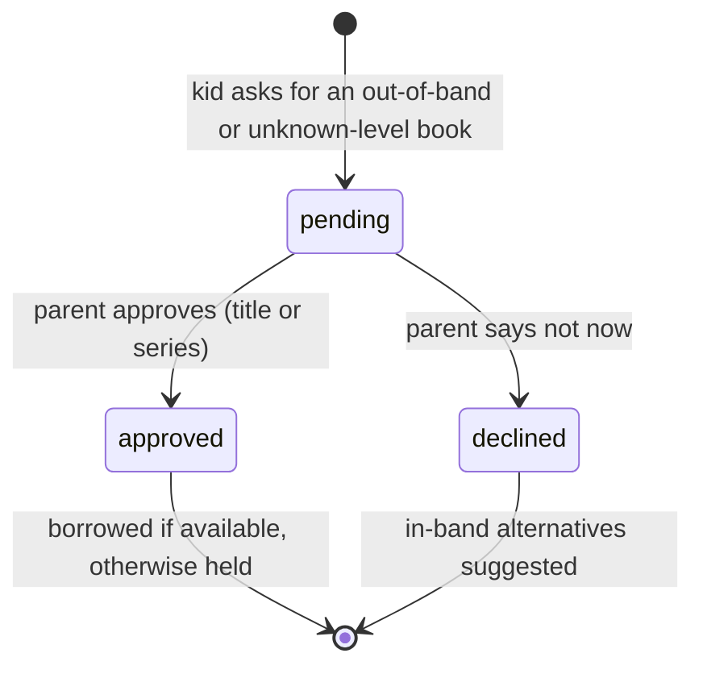

# Architecture

## Components

| Component | File | Job |
| --- | --- | --- |
| Web app | `public/` | Parent and kid screens. Calls `window.ReadarooAPI.call(method, path, query, body)` |
| HTTP adapter | `public/api-http.js` | Sends those calls to the server |
| Server | `server.js` | Express. Serves the app, forwards `/api/*` to the engine, checks configuration, shuts down cleanly |
| Engine | `src/engine.js` | Every product rule and the API router. Runs in Node and the browser |
| Offline store | `src/memoryStore.js` | In-memory copy of `data/seed.json`, plus a simulated meter |
| Live store | `src/postgresStore.js` | Same interface over Postgres |
| Stripe meter | `src/stripeMeter.js` | Records meter events in Stripe test mode; refuses live keys |
| Data generator | `data/generate_data.py` | Writes `data/seed.json` and `db/002_seed.sql` |
| Demo builder | `scripts/build-demo.js` | Inlines the app, engine, store and seed into `demo/readaroo-demo.html` |

The single-file demo replaces `api-http.js` with an adapter that calls `engine.handle()` directly, so the demo, the tests and the server share one code path.

## Data model

| Table | Key columns | Notes |
| --- | --- | --- |
| `app_config` | `key`, `value` | Pinned `now`, thresholds |
| `libraries` | `daily_cap_cents`, `monthly_cap_cents`, `spent_day`, `spent_today_cents`, `spent_month_cents`, `stripe_customer_id` | CHECK constraints keep spend at or under the caps |
| `families`, `members` | `role` (`parent`/`kid`), `band_min`, `band_max` | Kids store first name and age band only |
| `cards` | `family_id`, `library_id` | One row per library card |
| `titles` | `series`, `series_no`, `min_age`, `max_age`, `themes`, `pages`, `release_date`, `rating_pct`, `rating_count` | `min_age` NULL means reading level unknown; ratings are synthetic |
| `copies` | `owned`, `available`, `queue`, `as_of`, `ppu_cents`, `on_order` | Per title per library. `ppu_cents` NULL = no pay-per-use rights; `on_order` copies serve pre-release holds |
| `holds` | `position`, `status` | |
| `borrows` | `kind` (`standard`/`instant`), `finished_at`, `minutes_read`, `cost_cents`, `current_page`, `last_read_at` | Reaching the last page finishes the book |
| `approvals` | `status`, `scope` (`title`/`series`), `decided_by` | |
| `reactions` | `reaction` (`loved`/`ok`/`not_for_me`) | |
| `feedback` | `vote` (`up`/`down`) | Next-Up thumbs |
| `meter_events` | `idempotency_key` (PK), `stripe_id`, `mode` | One row per charge |
| `sessions` | `client_id` (unique), `borrow_id`, `day`, `minutes` (1–600), `to_page` | Reading time; a repeated save with the same `client_id` keeps the larger values |
| `tbr` | `member_id`, `title_id`, `added_by`, `source` | Want-to-read lists |
| `shelves`, `shelf_titles` | `min_age`, `max_age`, `curator`, `position` | Librarian starter shelves by age group |
| `follows` | `kind` (`author`/`series`), `value` | Drives Coming soon and picks |
| `meetups` | `starts_at`, `min_age`, `max_age`, `capacity`, `seats_taken`, `format` (`in_person`/`online`), `questions`, `question_count` | CHECK keeps seats at or under capacity |
| `rsvps` | `attendees` (member ids), `status` (`going`/`waitlist`/`requested`/`cancelled`) | One active booking per family per event |
| `authors` | `name` (PK), `emerging`, `debut_title_id`, `debut_year`, `hometown`, `followers`, `bio` | `emerging` = first book in the last three years |
| `community_signals` | `title_id`, `library_id`, `requests`, `loves` | Synthetic totals from other families. No individual data |
| `library_requests` | `member_id`, `title_id` (unique together), `library_id`, `status` (`requested`/`ordered`) | Ask my library. Librarians only ever see totals |
| `event_questions` | `meetup_id`, `member_id`, `text` (3–200), `status` (`waiting_parent`/`sent`/`declined`) | Kids' questions wait for a parent |
| `recommendations` | `from_member`, `to_member`, `title_id` (unique together), `note` (≤140) | In-family only; CHECK stops recommending to yourself |
| `events` | `seq`, `type`, `actor`, `data` | Append-only audit log |

## Identifiers

| Pattern | Example | Meaning |
| --- | --- | --- |
| `m-<name>` | `m-arjun` | Family member |
| `lib-<name>` | `lib-county` | Library |
| `t-<slug>` | `t-moonfox-2` | Title |
| `borrow-…`, `hold-…`, `appr-…`, `evt-…` | `borrow-mw0smix53` | Created by the engine |
| `borrow:<borrow id>` | `borrow:borrow-mw0smix53` | Stripe idempotency key / meter event identifier |
| `mtr_fake_0001` | | Simulated meter event id |

## Rules

**Availability.** A copy whose `as_of` is older than `staleHours` (24) is `check`, never `available`. Borrowing from it returns 409 `stale` until `/api/refresh` updates it.

**Wait estimate.** `ceil(position / owned) × daysPerQueueTurn` days, shown as a week range (60% to 100% of the estimate).

**Next-Up.** For a held title and a member: skip titles they've borrowed, titles outside their band, unknown levels and stale copies (the last two are listed as excluded). Score same series +3, same author +2, each shared theme +1. Keep scores above zero with a fresh available copy. Top three, ties by title.

**Age band.** A title is in band when its age range overlaps the kid's band. Unknown level counts as out of band. A kid's out-of-band request creates a pending approval. A parent acting for the kid is the approver, so no request is created.

**Instant borrow.** Offered only when all hold: series book 2 or later, no copy available, pay-per-use rights at a family library, shortest wait ≥ `instantWaitThresholdDays` (28), and the library has budget left today and this month.

**Reading sessions.** The reader counts time only while the page is visible (`readingSecondsPerMinute` real seconds per minute). It saves on Done for now, I finished the book, Back, switching apps (`visibilitychange`) and closing the tab (`pagehide`, sent with `keepalive`). Every save of one open book uses the same `clientId`, so the server keeps the larger minutes and page instead of adding twice.

**Streaks.** A day counts when a member reads at least `streakMinMinutes` (5). Walking back from today: each reading day adds one; today never breaks the streak; one missed day in any seven is a rest day; a second missed day within seven ends it. The longest streak is the best run ending on any reading day. Messages never scold: a broken streak becomes "Fresh start".

**Good picks.** For each released, in-band title the member hasn't borrowed: next in a series they finished +5; another book by an author they loved +3; each theme shared with a loved book +1; each theme shared with a "Not for me" book −1; a followed series or author +2; loved by 85%+ of readers that age (20+ ratings) +1; on their list +1. Keep scores above zero, top six, each with its reasons.

**New releases.** A title with `release_date` after today is "coming". Holds on it go to libraries with copies `on_order`, and the wait counts from release day. New arrivals are titles released within `newArrivalDays` at a family library.

**Events.** Upcoming events only. Kids see events for their age; parents see all, with "good for" names and reasons from what the family loved, read, is reading, saved or follows. A kid's Ask to go creates a request; only a parent books. Kids under 13 go with a grown-up: if none is ticked, the booking parent is added. Seats are taken with one conditional `UPDATE` (Postgres) so a room can't overfill; a full room puts the family on the waitlist and takes no seats.

## Instant borrow sequence

```mermaid
sequenceDiagram
  participant App
  participant Engine
  participant DB as Postgres
  participant Stripe
  App->>Engine: POST /api/instant
  Engine->>Engine: eligibility + approval gate
  Engine->>DB: BEGIN; SELECT library FOR UPDATE
  alt over daily or monthly cap
    DB-->>Engine: refuse (COMMIT, nothing spent)
    Engine->>DB: hold at shortest line, event instant.refused
    Engine-->>App: instant_refused + hold + Next-Up
  else under cap
    DB-->>Engine: spend reserved (COMMIT)
    Engine->>Stripe: meter event, identifier borrow:<id>
    alt Stripe error
      Engine->>DB: release budget, event instant.meter_failed
      Engine-->>App: 502, nothing charged
    else ok
      Engine->>DB: meter_events row, borrow, event instant.borrowed
      Engine-->>App: instant_borrowed
    end
  end
```

## Approval states



## Event catalog

| Type | When | Data |
| --- | --- | --- |
| `borrow.created` | Standard borrow | `borrowId`, `titleId`, `memberId`, `libraryId` |
| `hold.placed` | Hold at the shortest line | `holdId`, `libraryId`, `position`, `compared` |
| `instant.borrowed` | Instant borrow metered | `priceCents`, `meterId`, `mode` |
| `instant.refused` | Over a cap | `libraryId`, `reason`, `priceCents` |
| `instant.meter_failed` | Stripe error; budget released | `error` |
| `approval.requested` / `approved` / `declined` | Approval lifecycle | `approvalId`, `titleId`, `scope`, `reason` |
| `reaction.added` | Kid reaction | `borrowId`, `reaction` |
| `nextup.feedback` | Good pick / Not for us | `heldTitleId`, `suggestedTitleId`, `vote` |
| `availability.refreshed` | Simulated library sync | `titleId`, `libraries` |
| `reading.saved` | A reading session saved (or a repeat save that added time) | `borrowId`, `minutes`, `toPage`, `retry` |
| `reading.finished` | Last page reached | `borrowId`, `titleId` |
| `list.added` / `list.removed` | Want-to-read list change | `titleId`, `memberId` |
| `follow.added` / `follow.removed` | Follow change | `kind`, `value` |
| `meetup.requested` / `meetup.rsvp` / `meetup.declined` / `meetup.cancelled` | Event requests and bookings | `meetupId`, `status`, `attendees`, `released` |
| `library.requested` | Ask my library | `titleId`, `memberId`, `libraryId` |
| `library.ordered` / `library.request_fulfilled` | Librarian added copies; each family who asked is logged | `titleId`, `libraryId`, `copies`, `families` |
| `question.requested` / `question.sent` / `question.approved` / `question.declined` | Questions for authors | `meetupId`, `questionId` |
| `recommendation.sent` | In-family recommendation | `titleId`, `to` |

## Security model

- The app connects as `readaroo_app`: SELECT on all tables, INSERT/UPDATE on working tables, INSERT only on `events` (no UPDATE or DELETE).
- Stripe keys must be test keys; the check runs at startup and in `stripe:setup`.
- The server binds to `127.0.0.1` by default and has no authentication. "Acting as" is a demo control.
- Request bodies over 50 KB are rejected; malformed JSON returns 400.

## Design decisions

| Decision | Why |
| --- | --- |
| One engine for server, tests and demo | The demo can't promise behavior the app lacks |
| Rules-based Next-Up, not a model | Explainable reasons, deterministic tests, no API key needed |
| Reserve budget before metering, release on failure | Never charge over the cap; never keep budget for a failed charge |
| Pinned clock in `app_config` | Demo records behave the same on every run |
| Parent acting for a kid skips approval | The parent is the approver; asking themselves adds friction |
| Stale data blocks borrowing | Showing "available" from old data would break trust at the library desk |
| Reader saves by session id, keeping the max | Closing a tab can fire several saves; none should double count |
| A weekly rest day in streaks | Keeps the motivation without punishing a sick day |
| Kids ask, parents book events | Kids under 13 shouldn't be booked into public events alone |
| Picks always show reasons | Parents and kids can see why, and "Not for me" visibly changes them |
